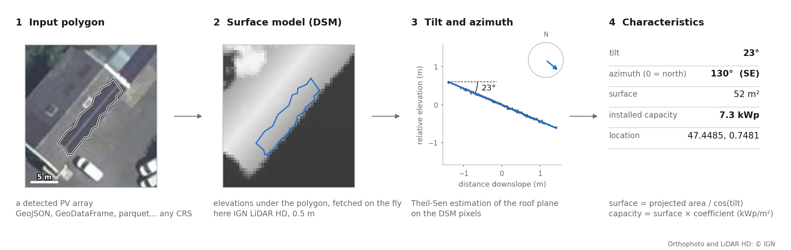

# PyPVRoof

[](https://huggingface.co/spaces/TODO/pypvroof)
[](https://doi.org/10.5281/zenodo.7586879)

PyPVRoof extracts the characteristics of rooftop PV systems from geocoded polygons.

- **Outputs:** tilt, azimuth, installed capacity (plus surface and location).
- **Inputs:** the polygons, and optionally a digital surface model (DSM). Open
  DSMs of several European countries are queried on the fly (see
  [Covered countries](#covered-countries)); local GeoTIFFs work too. Without a
  DSM, heuristics give an estimate from the polygon alone.

<p align="center">

</p>

**Try it** online on [Hugging Face Spaces](https://huggingface.co/spaces/TODO/pypvroof):
draw a polygon on a roof anywhere in the covered countries and get its
characteristics on the fly, or upload a file of polygons. Locally:
`pip install -e ".[viz]" gradio && python app/app.py`.

## Methods

### Tilt

- **With a DSM:** the elevations under the polygon are fitted with a robust
  Theil-Sen estimator: planes through random triplets of neighbouring pixels,
  modes of their slopes (one per orientation, with as many parallel planes as
  needed), least-squares refit on the inliers. Polygons covering several roof
  planes with different orientations are flagged `multimodal`, or split into
  one part per plane (`split=True`): gable roofs, but also large roofs with
  many pans (repeated gables, sheds).
- **Without a DSM:** a constant (30° by default, `constant-tilt`).

### Azimuth

- **With a DSM:** from the same Theil-Sen fit. Undefined on flat roofs
  (`status = "flat"`, tilt under 5°).
- **Without a DSM:** the orientation of the polygon's minimum rotated
  rectangle, facing the side closest to south. It gives the axis of the
  installation only, and can be wrong by 180°.

Azimuths are in degrees, **0 = north, clockwise** (90 = east, 180 = south).

### Installed capacity

The installed capacity (kWp) is proportional to the surface of the panels: the
projected surface of the polygon divided by the cosine of the tilt. The
coefficient (`regression-type`) is either a constant (`default-coefficient`,
1/6.5 kWp/m²), or calibrated on the BDPV registry shipped with the package:
one coefficient (`linear`) or one per surface class (`clustered`).

## Covered countries

| Country / region | Service | Product | Resolution | CRS | Protocol | Licence |
|---|---|---|---|---|---|---|
| France | `fr-lidar` | IGN LiDAR HD | 0.5 m | EPSG:2154 | WMS-R | Etalab 2.0 |
| France | `fr-correl` | IGN MNS Correl (from aerial images, less precise) | 0.5 m | EPSG:2154 | WMS-R | Etalab 2.0 |
| Netherlands | `nl-ahn` | AHN | 0.5 m | EPSG:28992 | WCS 2.0.1 | CC0 |
| Belgium (Flanders) | `be-flanders` | DHMV II (2013-2015) | 1 m | EPSG:31370 | WCS 2.0.1 | Modellicentie gratis hergebruik |
| United Kingdom (England) | `uk-england` | Environment Agency LiDAR composite DSM | 1 m | EPSG:27700 | WCS 2.0.1 | OGL v3 |
| Germany (North Rhine-Westphalia) | `de-nw` | DOM1 | 1 m | EPSG:25832 | WCS 2.0.1 | dl-de/zero-2-0 |
| Germany (Mecklenburg-Vorpommern) | `de-mv` | DOM1 | 1 m | EPSG:25833 | WCS 2.0.1 | CC BY 4.0 |
| Poland | `pl` | GUGiK NMPT (slow, ~7 s per polygon) | 0.5 m | EPSG:2180 | WCS 1.0.0 | GUGiK |
| Norway | `no` | Nasjonal høydemodell DOM | 1 m | EPSG:25833 | WCS 1.0.0 | CC BY 4.0 |
| Switzerland | `ch-swisssurface3d` | swisstopo swissSURFACE3D | 0.5 m | EPSG:2056 | STAC + COG | swisstopo OGD |
| Anywhere | path to a folder | your GeoTIFFs (pixel = elevation in metres) | any | any projected | local files | yours |

Polygons can be given in any CRS. At 1 m, polygons under about 12 m² have too
few pixels to be measured. `pypvroof.available_services()` returns this table.

## Installation

```bash
pip install pypvroof
```

From source: `git clone https://github.com/gabrielkasmi/pypvroof.git && cd pypvroof && pip install -e ".[dev]"`. Python >= 3.9.

## Usage

Tilt and azimuth measured on a DSM, for a whole file:

```python
from pypvroof import characterize_roofs

out = characterize_roofs("detections.geojson", "fr-lidar", workers=8)
```

The input can be a GeoDataFrame, a GeoJSON, a parquet file, a list of shapely
polygons... The output is a GeoDataFrame with `tilt`, `azimuth`, `surface`, a
`status` (`ok`, `flat`, `multimodal`, `no_coverage`, `too_few_points`...) and
the service metadata (`meta_*`, e.g. the LiDAR acquisition date). No fallback
is applied: when a value cannot be measured, `status` says why and you choose
what to do (another service, the heuristics...).

All characteristics, including the installed capacity:

```python
from pypvroof import MetadataExtraction

params = {
    "tilt-method": "theil-sen",      # or "constant"
    "azimuth-method": "theil-sen",   # or "bounding-box"
    "dsm-service": "fr-lidar",            # a service from the table, or a folder of GeoTIFFs
    "regression-type": "linear",     # or "constant", "clustered"
}
df = MetadataExtraction(p=params).extract_all_characteristics("detections.geojson")
```

Visual check of a polygon (orthophoto and DSMs, `pip install "pypvroof[viz]"`):

```python
from pypvroof.viz import plot_polygon
fig = plot_polygon(polygon, services=("fr-lidar", "fr-correl"))
```

See the [API documentation](docs/api.md) for all parameters and statuses.

## Contributing: add a service

Your country is not in the table? Most national LiDAR surface models are
published as an OGC WCS (or STAC + Cloud-Optimized GeoTIFFs), and adding one
is usually a single entry in [`pypvroof/catalog.py`](pypvroof/catalog.py).
See [CONTRIBUTING.md](CONTRIBUTING.md) for the step-by-step guide, then open a
pull request.

## Citation

```
@article{tremenbert2023pypvroof,
  title={PyPVRoof: a Python package for extracting the characteristics of rooftop PV installations using remote sensing data},
  author={Tr{\'e}menbert, Yann and Kasmi, Gabriel and Dubus, Laurent and Saint-Drenan, Yves-Marie and Blanc, Philippe},
  journal={arXiv preprint arXiv:2309.07143},
  year={2023}
}
```

PyPVRoof expands the characteristics extraction module of [Kasmi et al. (2022)](https://arxiv.org/abs/2207.07466).

## License

MIT, see [LICENSE](LICENSE). The surface models belong to their producers and
are used under their licences (see the table above).
